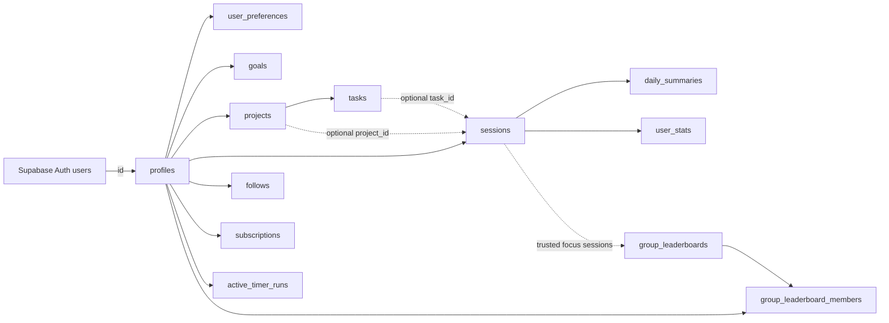

# Database, Features, and RLS
This is a feature-oriented guide to Depthly's current Supabase data model. It explains how records connect and which security boundary protects each feature. The numbered migrations are the executable source of truth; check them when this guide and the SQL differ.

## How the data layer fits together

The focus session log (`sessions`) is the durable event record. Timer RPCs create it and update derived totals in `daily_summaries`, `user_stats`, and `profiles`. Projects and tasks provide optional organization for that work. Social features read carefully scoped projections or RPC results instead of exposing another user's private base rows.

## Tables

All user-owned records ultimately reference `profiles.id`, which is provisioned from `auth.users.id`. Deleting a user cascades through their personal records. Project/task deletion nulls references on saved sessions so historical time is retained.

| Table | What it stores | Important links / behavior |
|---|---|---|
| `profiles` | Account-facing identity, profile visibility, plan/billing state, aggregate focus totals and streaks. Trusted aggregate columns distinguish verified timer activity. | `id` is the Auth user ID. Parent for nearly all user data. Public reads use `public_profiles`, not this base table. |
| `user_preferences` | Per-user timer defaults, durations, auto-start preferences, sound/reminder settings, and theme. | One row per user; `user_id → profiles.id`. |
| `goals` | Daily and weekly focus targets, stored as integer minutes. Null means no target is set. | One row per user; `user_id → profiles.id`. |
| `projects` | Named, colored work areas with archive state, order, and last-used timestamp. | `user_id → profiles.id`; sessions may reference a project. |
| `tasks` | Project tasks: title, description, status, priority, due date, completion time, estimates, actual Pomodoros, and separate list/board ordering. | `project_id → projects.id`; `user_id → profiles.id`. `list_order` and `kanban_order` are independent. |
| `sessions` | Durable focus and break events: type, duration, start/end times, notes/title, local date, timer mode, trust/exclusion metadata, and optional project/task references. | `user_id → profiles.id`; nullable `project_id` and `task_id`. Authoritative source for history and most aggregates. |
| `daily_summaries` | Per-user, per-local-date focus minutes, focus-session count, goal-met flag, and trusted equivalents. | Unique `(user_id, date)`; derived from completed focus sessions. |
| `user_stats` | Per-user totals keyed by period type and period key for leaderboard queries. Includes trusted totals. | Unique `(user_id, period_type, period_key)`; derived from focus sessions. |
| `follows` | Friend requests and accepted friendship edges, with requester, recipient, status, and creation time. | Two accepted directional rows represent a mutual friendship. Self-follow is forbidden. |
| `subscriptions` | Subscription lifecycle, plan/interval/status, provider identifiers, period dates, cancellation state, and amount in cents. | `user_id → profiles.id`; webhook maintained. Historical column names still include `stripe_*` even though Lemon Squeezy is used. |
| `active_timer_runs` | At most one active or paused server-authoritative timer per user: phase, mode, target, elapsed anchor, timezone, selected project/task, title, and notes. | Unique `user_id`; project/task references are nullable. Converted into a `sessions` row when finished. |
| `group_leaderboards` | Private group configuration: owner, name, period/timezone, optional goal, invite code, status, and closed-period snapshot metadata. | `owner_id → profiles.id`; accessed through group RPCs. |
| `group_leaderboard_members` | Group membership, role/status, join/leave timestamps, and frozen score for closed groups. | `leaderboard_id → group_leaderboards.id`; `user_id → profiles.id`; unique per group/user. |

Additional database objects:

- `public_profiles` is a restricted view for public profile, search, and leaderboard surfaces. It omits billing identifiers and other private profile columns.
- `avatars` is a Supabase Storage bucket. Its object path starts with the owner's user UUID.
- `period_type`, `plan_type`, `session_type`, `timer_mode_type`, task status/priority, and subscription enums constrain stored values; see `supabase/CURRENT_SCHEMA.md` and migrations for the exact enum members.

## Feature flows

### Sign up and profile

Supabase Auth creates `auth.users`. A database trigger creates the associated `profiles`, `user_preferences`, and `goals` rows. The profile row contains both user-editable identity fields and server-managed plan, billing, trust, and aggregate fields. Profile changes go through `update_my_profile`, which accepts only an explicit allowlist of public-facing fields and validates them server-side.

Other users' profile surfaces query `public_profiles`. The view returns rows that are public, belong to the caller, or are connected through follows. Private profile fields remain available only from the owner's base `profiles` row.

### Timer, sessions, and aggregates

1. The client starts, pauses, resumes, cancels, or finishes a timer through `start_timer_run`, `pause_timer_run`, `resume_timer_run`, `cancel_timer_run`, and `finish_timer_run`.
2. `active_timer_runs` stores the trusted timer state. A unique user constraint prevents parallel active runs; timer RPCs check the caller and run owner.
3. `finish_timer_run` calculates the saved duration from server timestamps, inserts a `sessions` record, and updates focus aggregates transactionally. Client supplied elapsed time is not the source of truth.
4. The aggregate helper updates daily and period totals, profile totals/streaks, and task Pomodoro counts. Clients cannot call this internal helper or write aggregate tables directly.
5. Session editing is limited to metadata through `update_session_metadata`; saved timing cannot be rewritten through direct table access.

The legacy `save_session` RPC remains in migration history, but is not the current client write path. Direct session insert/update/delete is revoked. All saved focus sessions count toward totals; the old exclusion RPC is not executable by clients.

### Projects and tasks

Projects are created by `create_project` and archived/restored with `set_project_archived`; these functions enforce the plan limit on the server. Owners can directly update only project presentation/order fields (`name`, `color`, `icon`, `sort_order`, `last_used_at`). Task rows support owner-scoped direct CRUD under RLS and explicit grants. Project/task queries feed the timer selector, project views, and session history.

### Goals, home, and analytics

`goals` contains the target; `daily_summaries` supplies today's achieved minutes and session count. The Home page compares them. Analytics reads summaries and session detail through `get_analytics_daily_summaries` and `get_analytics_sessions`, which enforce caller identity and apply the Free plan's seven-day window server-side. The Sessions page uses the owner's full history through `get_sessions_page`, which applies filters before pagination and scopes results to `auth.uid()`.

### Friends and public leaderboards

`follows` stores requests and accepted links. RLS exposes only relationships involving the caller. Profile display uses `public_profiles`; friend-period totals use `user_stats` policies/helpers that permit the owner, public profiles, and accepted friends as appropriate. Global leaderboard and rank RPCs apply public-profile and plan eligibility server-side. These features do not grant direct access to another user's base `profiles` row.

### Private group leaderboards

Both group tables have RLS enabled and all direct `anon`/`authenticated` table privileges revoked. `SECURITY DEFINER` RPCs create groups, preview invite codes, join/leave, fetch member views/rankings, remove members, and close a group. Each private read checks membership; invite preview is the intentionally limited public exception. Ranking counts trusted focus sessions in the group's period and timezone. Closing freezes member totals and disables the invite.

### Plans and billing

`profiles.plan` is the fast-read entitlement state. `subscriptions` stores billing history. The Lemon Squeezy Edge Functions use the service role for checkout/account lifecycle work; the webhook verifies the provider signature before applying subscription and profile plan changes. The browser never receives the service role key. Plan gates such as project/session/group limits and analytics/export restrictions are enforced in server RPCs, not trusted to client UI checks.

## RLS and database privileges

RLS answers **which rows** a role can see or change. SQL grants answer **which operations** that role can attempt. Both layers must allow an action. Migration `024_reconcile_client_privileges.sql` clears inherited client grants and rebuilds the intended least-privilege grants; `025` adds owner-scoped session pagination; later migrations refine group periods and ranking.

| Table / surface | Authenticated client access | RLS rule / protected write path |
|---|---|---|
| `profiles` | SELECT only on own row. No direct client INSERT/UPDATE/DELETE. | `id = auth.uid()`. `update_my_profile` writes a small validated field allowlist. Public/friend reads use the narrow view. |
| `user_preferences` | SELECT, UPDATE. | `user_id = auth.uid()` for reads and updates. |
| `goals` | SELECT, UPDATE. | `user_id = auth.uid()`. Initial row comes from signup provisioning. |
| `projects` | SELECT, DELETE, and column-limited UPDATE. No direct INSERT. | Owner row policies. Creation and archive state go through plan-aware RPCs. |
| `tasks` | SELECT, INSERT, UPDATE, DELETE. | Owner policies require `user_id = auth.uid()` on the row. |
| `sessions` | SELECT only. | `user_id = auth.uid()`. Writes use trusted timer RPCs; direct client mutations are revoked. |
| `daily_summaries` | SELECT only. | `user_id = auth.uid()`. Written by internal timer aggregation. |
| `user_stats` | SELECT only. | Own rows, eligible public rows, or accepted-friend rows via secured policies/helpers. No client writes. |
| `follows` | SELECT, INSERT, UPDATE, DELETE. | Reads involve caller as requester or recipient; insert requires caller as requester; recipient may accept/update; either side may remove the relationship under the relevant policy. |
| `subscriptions` | SELECT only. | `user_id = auth.uid()`. Service-role webhook performs writes. |
| `active_timer_runs` | SELECT only. | `user_id = auth.uid()`. Timer lifecycle writes go through owner-checking RPCs. |
| `group_leaderboards`, `group_leaderboard_members` | No direct table grants. | RLS enabled; use membership-checking RPCs. |
| `public_profiles` view | SELECT for authenticated; SELECT for anonymous. | View filter exposes only non-sensitive columns for public profiles, self, or follows connections. No base-table anon grants. |

Client access is also constrained by explicit grants. Migration `024` revokes table, sequence, and function privileges from `PUBLIC`, `anon`, and `authenticated`, then grants back only the supported surface. Do not treat a UI check or an RLS policy alone as a complete authorization design.

## Security rules of thumb

- Use `auth.uid()` inside policies and write RPCs. Never trust a client-supplied user ID as proof of ownership.
- Every `SECURITY DEFINER` function must set a safe `search_path`, authenticate where needed, verify row ownership or membership, validate arguments, and have explicit `EXECUTE` grants.
- Some narrow helpers remain callable by `anon` because the public profile view and public leaderboard policies call them. Do not revoke those grants without checking dependent views and policies.
- Keep sensitive columns on owner-only base rows. For sharing, add a narrow view or purpose-built RPC rather than broadening base-table row access.
- Never add direct client write paths for session timing, aggregates, plan/billing state, trust flags, or group membership tables.
- Recheck both grants and RLS when adding a table. Default client privileges are revoked by migration `024`; a new table needs explicit grants and policies.
- Storage policies are separate from database-table RLS. Avatar uploads/updates/deletes are scoped to the caller's UUID folder; reads are public by design.
- Verify security changes against the live database as well as migration SQL. Hosted Supabase grants or migration drift can differ from a clean local replay.

## Source references

- Schema inventory: [`supabase/CURRENT_SCHEMA.md`](../supabase/CURRENT_SCHEMA.md)
- RLS audit and historical incidents: [`SECURITY.md`](SECURITY.md)
- Trusted timer lifecycle: [`TRUSTED_SESSIONS.md`](TRUSTED_SESSIONS.md)
- Feature implementation docs: [`PROJECTS.md`](PROJECTS.md), [`TASKS.md`](TASKS.md), [`ANALYTICS.md`](ANALYTICS.md), [`FRIENDS.md`](FRIENDS.md), [`GROUP_LEADERBOARDS.md`](GROUP_LEADERBOARDS.md), [`BILLING_STATUS.md`](BILLING_STATUS.md)
- SQL source: [`supabase/migrations/`](../supabase/migrations/)

