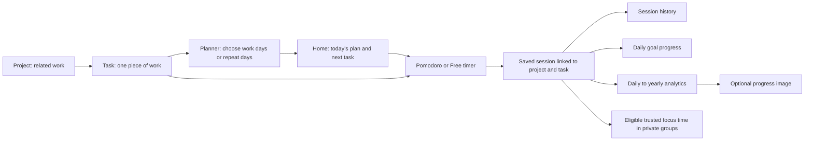

# Depthly — Product Overview

Last reviewed: November 15, 2026. Pricing and feature limits below reflect the current repository; payment-provider configuration and deployed behavior must be checked separately before publishing changes.

## What is Depthly?

Depthly is a focus and time-tracking web app that connects planned work to recorded progress. Users organize work into projects and tasks, choose what to work on, run a focus session, and see how their time contributes to daily goals and longer-term habits.

**Website:** https://www.getdepthly.com

**Company:** Depthly is a product of OMBRIVA LLC.

**Contact:** contact@getdepthly.com

**Short description:** Plan your tasks, track focused sessions, and see where your time goes.

**Core promise:** Choose a task. Track your focus. See your progress.

## Who it is for

### Students — primary acquisition audience

Students who already use a study timer or track study hours, especially when preparing for exams, completing assignments, or following a study plan.

- Problem: study time is recorded separately from the subject or task, making progress hard to review.
- Use: create a course or exam project, add study tasks, schedule them, and record sessions against them.
- Example: **Biology exam → Review cell division → 25-minute session → Daily goal and study history.**
- Buyer/user: primarily an individual student paying for their own workspace; a free user can also participate in a study group.

### Freelancers — secondary acquisition audience

Independent workers who want to understand how much focused time goes into client projects and deliverables.

- Problem: tasks, plans, and time records are disconnected, or an existing tool feels more complicated than their personal workflow requires.
- Use: organize client work, plan deliverables, focus on a task, and review time by project.
- Example: **Client website → Draft homepage copy → 45-minute session → Project time and weekly progress.**
- Buyer/user: a freelancer managing their own work, rather than a company buying an employee-management system.

### Independent learners and remote workers

People building a consistent personal work or learning routine. They can start alone and optionally invite peers for accountability.

These audiences are positioning choices, not evidence of validated demand. This document does not claim customer counts, revenue, or measured productivity improvements.

## How the features work together

A project groups related tasks. A task can have multiple sessions. Planning assigns when to work on a task; a due date records its deadline. A session records time spent, and does **not** automatically mean the task is finished. The user explicitly marks a task complete.

Sessions can also be recorded without a project or task. Planning and group participation are optional.

## Features

### 1. Home dashboard

- Personalized greeting and today's focus/session totals.
- Focus timer with a suggested next task from today's plan.
- Today's planned tasks, completion controls, and task selection for focus.
- Reminder of unfinished planned work and links to the Planner.
- Recent sessions with access to their details.
- Circular daily-goal progress and remaining minutes.
- Weekly focus chart and shortcuts to projects, analytics, and sessions.

### 2. Focus timer

- **Pomodoro:** countdown sessions with configurable focus and break durations.
- Presets include 25/5, 50/10, and 90/20, plus custom durations within Pomodoro.
- **Free:** stopwatch mode for open-ended work.
- Start, pause, resume, stop/save, and break controls.
- Optional project/task association, session notes, and a timer todo panel.
- Fullscreen timer presentations and configurable session preferences.
- Server-maintained active timer state supports recovery after refresh or reopening the app.

Custom is no longer a separate visible timer mode. Server timing, rather than a client-supplied duration alone, underpins new trusted sessions.

### 3. Projects

- Create and edit named projects with a color and icon.
- Switch between list and card views.
- Search, filter, and sort projects, including creation-date ordering.
- View project focus time, completed-task totals, and last-focused information.
- Archive and restore projects; archived work remains distinct from active work.
- Open project details to manage tasks or review related sessions.

### 4. Tasks

- Tasks belong to projects and support descriptions, status, priority, and deadlines.
- To do, In progress, and Done states.
- List and Kanban views with separate ordering.
- Task search/filtering, completion controls, and detail editing.
- Estimated Pomodoros, recorded sessions, and focus time provide work context.
- Optional work dates, planning windows, and repeat rules connect tasks to the Planner.

### 5. Planner and repeating tasks

- Today, week, and month views.
- Assign a specific work day independently from the task deadline.
- Plan work within a week or month window.
- Today's tasks, unfinished work, suggested tasks, and unscheduled work.
- Explicitly reschedule unfinished tasks rather than silently moving them.
- Repeat every day, on weekdays, or on selected weekdays, with optional date bounds.
- Complete or skip a specific repeat occurrence while preserving earlier history.
- Start the focus workflow with a selected task and project.

Repeating tasks remain one task with dated occurrence states; the app does not create a new task copy each day. Visible unfinished-work reminders are available; scheduled email, browser-push, and calendar-provider notifications are not established features.

### 6. Session history

- Browse recorded focus sessions and breaks.
- Search and filter by supported history fields, dates, project, type, and duration.
- Paginated history with date grouping.
- Session details show time, duration, project/task, and notes.
- Edit supported session metadata; trusted saved timing is not an ordinary editable field.
- CSV export for eligible paid accounts.

### 7. Goals and analytics

- Daily and weekly focus targets.
- Daily goal completion based on recorded focus time.
- Overview, Daily, Weekly, Monthly, and Yearly analysis.
- Focus totals, session counts, streaks, activity patterns, timelines, and project breakdowns where applicable to the selected view.
- Project filtering and period/date navigation.
- Monthly/yearly activity visualizations and review of longer-term habits.
- Share Progress generates an image from supported analytics views.

Free analytics access is limited to a seven-day window. Pro and Lifetime unlock full analytics history. Session history and analytics access are separate surfaces; do not describe the Free plan as deleting older sessions.

### 8. Private focus groups

- Invite-only focus circles for study partners, peers, or accountability friends.
- Daily, seven-day, or monthly rounds with an optional per-member goal.
- Member rankings based on eligible trusted focus sessions.
- Private membership and ranking views; a public profile is not required to join.
- Invite links, member management, leaving, and permanent group closure with frozen results.
- Weekly rounds start from the group's creation time and repeat every seven days.

The public global leaderboard is hidden from the current main product experience. Private Groups remain available. Do not market the global leaderboard as a primary current navigation feature.

### 9. Account, personalization, and onboarding

- Email/password and Google authentication.
- Profile name/avatar and optional public-profile visibility settings.
- Light, Dark, and System appearance preferences with a saved device preference.
- Theme controls in the landing navbar, app navbar, and Settings.
- Quick guide and contextual Projects guide, with replay through Help.
- Timer preferences and account-management controls, including account deletion.
- Terms of Service and Privacy Policy pages with section navigation.

### 10. Billing

- Free, recurring Pro, and one-time Lifetime options.
- Checkout and payment lifecycle integration through Lemon Squeezy.
- Selected paid plan carried through the authentication/checkout handoff.
- Current-plan information and billing-history presentation.
- Subscription cancellation controls for applicable recurring plans.

Billing transactions, webhook handling, cancellation, and refunds require their own end-to-end checks; a populated demo workspace does not validate payment processing.

## Pricing

Prices shown by the landing page, in USD:

| Plan | Price | Main allowances |
|---|---|---|
| Free | $0 forever | Up to 3 active projects; 50 focus sessions per month; 7-day analytics; Share Progress; join private groups; create 1 active group with up to 15 members |
| Pro Monthly | $5/month | Unlimited projects and sessions; full analytics history; CSV export; create up to 10 active private groups with up to 100 members each |
| Pro Yearly | $39/year | Same Pro features; equivalent to $3.25/month, billed yearly; 35% less than twelve $5 monthly payments |
| Lifetime | $79 once | Everything in Pro; the same group allowances; future updates and founding-member badge as advertised on the landing page |

- Group capacities include the creator. Group creation limits refer to active groups.
- Free members can join private groups without upgrading, subject to the group's capacity and membership rules.
- Free monthly session limits count focus sessions; breaks do not consume that allowance.
- The free plan is presented as requiring no credit card.
- These are product prices, not a guarantee of the exact checkout total in every location. Checkout is the authority for the actual order total.
- Lifetime maps to the internal `founding` entitlement; this is a one-time plan, not a recurring subscription.

## What makes Depthly useful beyond a basic timer

The value is the connection between the work and the time record. Users can answer:

- What should I work on today?
- Which task did I spend this session on?
- How much focused time went into a project?
- Am I moving toward my daily target?
- What has my work pattern looked like over the week or month?

Optional sharing and private groups add accountability after the personal workflow is useful. They are not required to start.

## Scope and boundaries

Depthly is currently a personal focus workspace with optional peer accountability. Do not present it as a full client-billing, payroll, invoicing, employee-monitoring, or enterprise project-management platform.

Do not claim native mobile apps, Google/Outlook calendar synchronization, AI task scheduling, push reminders, offline timer guarantees, or automatic completion of tasks unless those capabilities are separately implemented and verified.

The frontend includes PWA support, but installability should not be interpreted as complete offline functionality.

## Platform and security overview

- React, TypeScript, and Vite frontend, with Supabase authentication and database services.
- User-owned records are protected by database row-level security and explicit privileges.
- Timer lifecycle and sensitive multi-table operations use server-side functions.
- Payment processing uses Lemon Squeezy and server-side webhook handling.
- Public profiles and group views expose limited, intentionally scoped information.
- OMBRIVA LLC attribution is displayed in the landing and legal-page footers.

This is a product overview, not a security certification or legal assurance. Detailed implementation lives in `docs/DATABASE_AND_RLS.md`, `docs/SECURITY.md`, and the migrations.

## Source references for future updates

- Pricing copy: `src/components/landing/PricingSection.tsx`.
- Plan limits: `src/hooks/usePlan.ts` and the server-side enforcement migrations.
- Timer: `docs/timer.md` and `src/store/timerStore.ts`.
- Planning: `docs/PLANNER.md`.
- Tasks/projects: `docs/TASKS.md`, `docs/PROJECTS.md`.
- Dashboard: `docs/HOME.md` and `src/pages/HomePage.tsx`.
- Analytics/history: `docs/ANALYTICS.md`, `docs/TRUSTED_SESSIONS.md`, `docs/EXPORT_AND_PWA.md`.
- Private groups: `docs/GROUP_LEADERBOARDS.md`.
- Billing: `docs/BILLING_STATUS.md`.
- Acquisition lessons: `docs/depthly-marketing-rules.md`; historical suggestions there should not override current product behavior.
